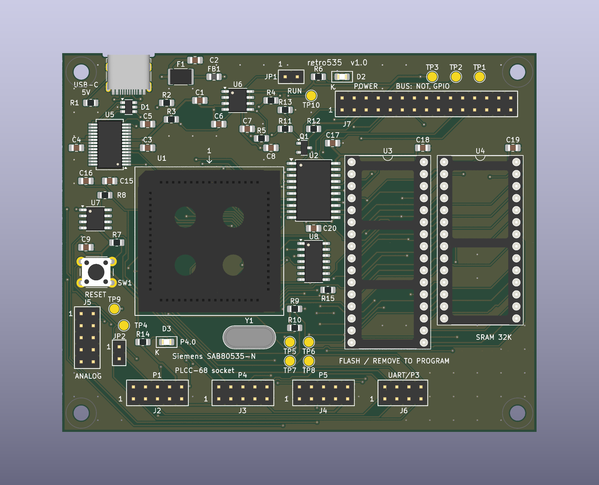

# retro535

**Siemens SAB80535-N Retro Development Board v1.0** — плата 100 × 80 мм,
два слоя, съёмный SAB80535-N в THT-панели PLCC-68, 64 КиБ доступного CODE
во внешней Flash и отдельные 32 КиБ SRAM. Питание USB-C; FT232RL UART,
RESET, пользовательский LED P4.0, разъёмы GPIO/аналоговых входов/шины.

**Статус: инженерный прототип, не испытан в железе.** Производственный архив
для первой пробной партии — `fabrication/retro535-v1.0-jlcpcb.zip`.
Контрольные результаты и границы проверки — `reports/release-review.md`.
Покупку, загрузку файлов и заказ в JLCPCB выполняет владелец платы.

## Открыть проект

Открыть `hardware/retro535.kicad_pro` в **KiCad 9.0.2 или новее**.
Главная схема `retro535.kicad_sch` включает ещё три редактируемых листа.
Плата `retro535.kicad_pcb` полностью разведена. Локальные символы,
footprints и 3D находятся рядом; сохранять структуру каталогов.

- [Архитектура, карта памяти, уровни и временной бюджет](docs/architecture.md)
- [Распиновка МК, разъёмов и контрольных точек](docs/pinout.md)
- [Сборка, первая прошивка и первое включение](docs/bring-up.md)
- [Параметры заказа JLCPCB](docs/manufacturing.md)
- [BOM с артикулами](docs/BOM.csv)
- [Схема PDF](docs/schematic.pdf)
- [Прошивка, сборка и бесплатная симуляция](firmware/README.md)
- [Datasheet и источники](docs/sources.md)
- [3D-модели и их ограничения](docs/models.md)

## Перед заказом и включением

МК ROMless: встроенного UART-загрузчика нет. USB-UART **не программатор**.
Первую прошивку и все обновления v1.0 записывают внешним программатором
в снятую SST39SF010A при полностью отключённой плате. Flash WE# на плате
заблокирован высоким уровнем; верхние 64 КиБ её 128-КиБ массива не используются.

JP1 сначала открыт: FT_PROG должен настроить USB bus-powered 500 mA,
CBUS3=PWREN# и pull-down on suspend. Основная часть включается после
enumeration; от зарядки без USB-хоста автономного старта нет. Под нагрузкой
нужно **>4,75 В на TP3**; слабый порт/длинный кабель может оставить МК в RESET.
GPIO — 5 В TTL. Периферию не подключать до успешного теста SRAM.

## Проверки и воспроизводимость

Схема создана из `tools/design.py`; `tools/generate.py` обновляет схему,
BOM и правила проекта, сохраняя отредактированную локальную библиотеку.
**Не запускать make_board.py/finish_board.py/polish_board.py на финальном
PCB:** это этапы построения, они могут затереть готовую разводку.
Для новой разводки использовать отдельную копию проекта.

`tools/sync_board_metadata.py` назначает служебные NC-цепи из актуального
`reports/netlist.xml` и синхронизирует библиотеку с проверенной геометрией.
`tools/audit_models.py` проверяет все файлы 3D. `tools/audit_manufacturing.py`
независимо проверяет Gerber/Drill и собирает ZIP; ему нужен `gerbonara`
и свежий `reports/pcb-geometry.json` из `tools/export_geometry.py` (KiCad Python). CLI KiCad, работающие с одним проектом,
запускать последовательно: они могут сохранять настройки даже при экспорте.

3D-рендеры показывают пустые панели U1/U3/U4. Панель PLCC и F1 — условные
модели; внешность не доказывает точную механику. На PCB присутствуют все
68 контактов U1 независимо от упрощений STEP.

GitHub: [adsdevdoo/retro535](https://github.com/adsdevdoo/retro535).
Инструкция SSH/plink для этой Windows-машины сохранена в `AGENTS.md`.
Сторонние 3D-модели сохраняют собственные лицензии; см. `docs/models.md`.
